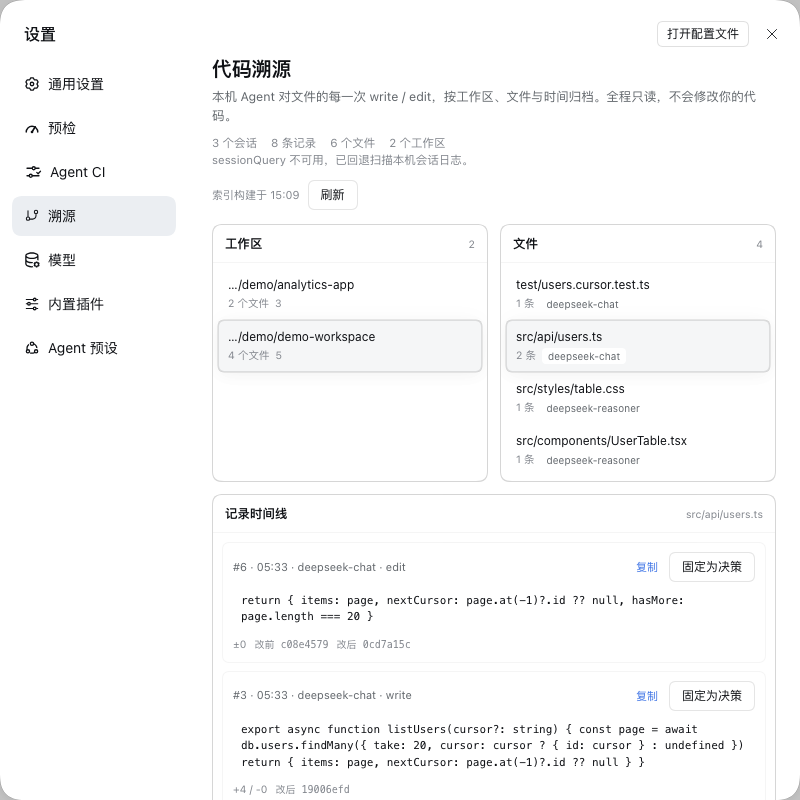
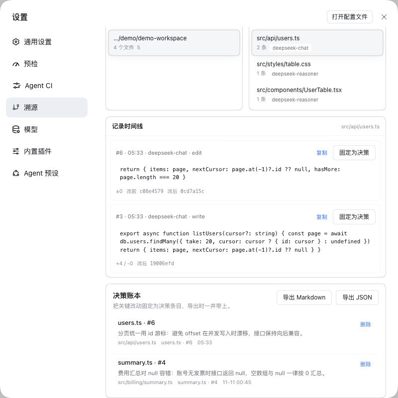
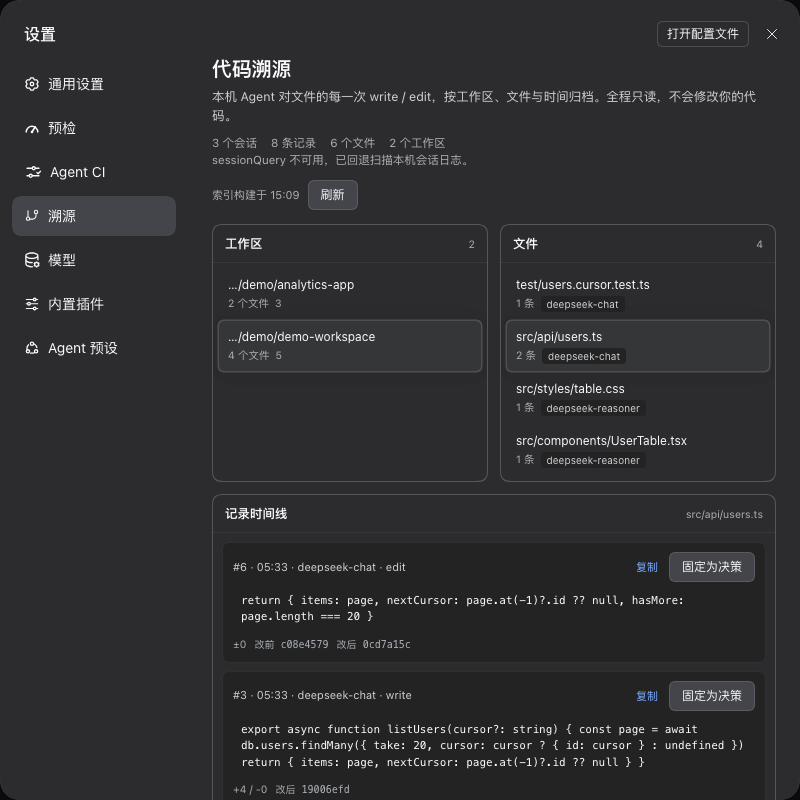

# dsh-provenance（溯源）

**Agent 代码改动的行级溯源 + 决策账本。** 回答「这行代码是谁写的——哪次会话、哪个模型、哪个工具」，并把关键改动固定为决策，导出 Markdown / JSON 审计记录。

## 截图





> 截图来自填充了合成会话的演示 profile，不包含任何用户数据。

## 安装

- **DSH 市场**：从社区插件目录安装 `@ruaibeite/dsh-provenance`（仓库需带 `dsh-plugin` topic）。
- **源码安装**：克隆本仓库，把 `@ruaibeite/dsh-provenance` 加入 web profile 的 `dsh.profile.bundles`（或把目录 symlink 到 profile 的 `node_modules/@ruaibeite/`），重启 DSH。页面出现在 **设置 → 溯源**（id `provenance`，order 5）。

## 它做什么

设置页内一个 master-detail 浏览器：

1. **工作区**：本机 Agent 改动过的工作区（最近优先）。
2. **文件**：每个工作区下被改动的文件、记录数、涉及的模型。
3. **记录时间线**：每条 `write` / `edit` 卡片：`#seq · 时间 · 模型 · 工具`、可复制 snippet、行数增减、改前/改后内容哈希，以及「固定为决策」按钮。
4. **决策账本**：自己固定的决策条目（可写备注「为什么这样改」），可随时删除。
5. **导出**：Markdown（人读审计）或 JSON（机器读），由浏览器直接下载。

三栏会自适应设置弹窗的窄宽度：工作区与文件列表并排放在第一行，记录时间线占满整行；长代码片段在卡片内换行，不再被右侧裁掉。

相对路径按会话工作目录解析；工作目录外的绝对路径也会保留（relPath 为空）。

## 如何工作

- Host 半区**只读**本地会话历史：优先 `ctx.sessionQuery.listSessions()` / `readSession(id)`；该服务不可用时回退扫描 `$DSH_HOME/sessions/**/session.v4.jsonl.zstd`，逐帧解压全部 Zstandard 帧（JSONL 后端每次 flush 追加一帧，单帧解压会漏数据）。
- 只处理 `tool/call` 中工具名为 `write` / `edit` 的事件。模型取自最近的 `assistant/message` source，turn/step 取自 tool call；`tool/result` 标记 `ok:false` 的调用会被过滤。
- 记录按工作区 + 文件聚合，缓存到 `$DSH_HOME/cache/provenance/index.json`。索引超过 5 分钟后台重建（单并发），或点「刷新」强制重建。单文件保留最新 200 条，全局上限 2 万条。决策单独存 `$DSH_HOME/cache/provenance/decisions.json`，增删不触发重建。
- 浏览器半区只请求本插件同源路由（`GET|POST /dsh-provenance/api`），不 import 任何 `@deepseek-ai/*`，只用主题 token。

## 隐私

- **纯本机**：不联网、不上传、无遥测。
- **只读**：不写会话日志、不 append 事件、不改你的仓库。
- **只写自己的缓存**：仅 `$DSH_HOME/cache/provenance/index.json` 与 `decisions.json`（临时文件 + rename 原子写）。
- 不读取凭据文件，不把 prompt 打进日志。

## 已知限制（v0.1.0）

- 只追踪内置的 `write` / `edit` 工具调用；通过 shell 重定向、formatter、外部编辑器、git 等产生改动**不可见**。
- 记录的是「调用意图」，不是最终文件行号——代码会继续变化，请用内容哈希（sha256 前 16 位）定位。
- 仅当对应的 `tool/result` 带 `ok:false` 时才会过滤失败调用；会话中断时仍可能列出「尝试过」的改动。
- 路径用 `path.resolve` 规范化，不解析符号链接。
- 跳过 subagent 会话（`delegationDepth > 0`）以减少噪声。
- 决策账本是轻量 ADR：备注由用户填写，暂不自动生成 ADR 文档。
- 只索引 `sessionQuery` 可见（或本地日志存在）的会话，最多最近 200 个会话、单会话 5 万事件。

## 验证

```sh
cd dsh-provenance
node --check index.js && node --check client.js
npm test        # host.mjs（31 项）+ render.mjs（14 项），无浏览器 / 无网络 / 不碰真实 ~/.dsh
```

测试全部使用内联 fixture 与临时 `DSH_HOME`。

## 许可证

MIT。
